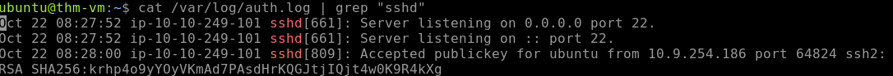
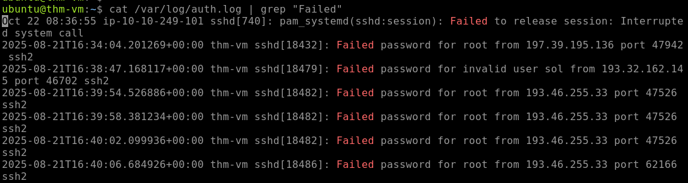
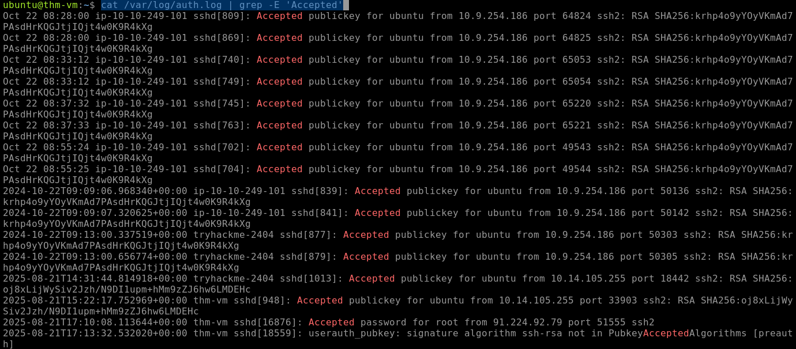

# Linux Threat Detection Investigation Series

## Threat Detection 1 — Initial Access

### Lab Environment

This investigation was conducted in a controlled TryHackMe lab environment using the Linux Threat Detection 1 machine.

- **Platform:** TryHackMe
- **Room:** Linux Threat Detection 1 v5
- **Lab Target:** `10.66.178.85`
- **Focus:** Linux initial access and threat detection

### Investigation Overview

The purpose of this lab is to investigate how attackers can gain initial access to Linux systems through common attack techniques. The investigation focuses on SSH security, Internet-exposed services, and process analysis to identify how suspicious activity originated and how it can be detected through available Linux logs.

The exercises build on Linux logging concepts and provide hands-on practice identifying activity that could indicate an attempted or successful compromise.

### Investigation Objectives

- Analyze the security risks associated with SSH in Linux environments.
- Identify how exposed services can provide attackers with an entry point.
- Use process and parent-child relationships to trace suspicious activity back to its origin.
- Analyze Linux logs for evidence of initial-access activity.
- Develop a better understanding of how a SOC analyst can detect and investigate Linux attacks.

## Task 2 — Initial Access via SSH

### Question 1 — First SSH Login

**Question:** When did the `ubuntu` user log in via SSH for the first time?

**Answer:** `2024-10-02`


### Evidence



```bash
cat /var/log/auth.log | grep "sshd"
```

### Question 2 — SSH Authentication Method

**Question:** Did the `ubuntu` user use SSH keys instead of a password for the above found date?

**Answer:** **Yes**

### Evidence

I reviewed the SSH authentication logs using the following command:

```bash
cat /var/log/auth.log | grep "sshd"
```
The relevant information that confirmed this:

```bash
Oct 22 08:28:00 ip-10-10-249-101 sshd[809]: Accepted publickey for ubuntu from 10.9.254.186 port 64824 ssh2: RSA SHA256:krhp4o9yYOyVKmAd7PAsdHrKQGJtjIQjt4w0K9R4kXg
```


### Task 3: Detecting SSH Attacks


Investigation Overview:
SSH attacks can occur when public SSH access is exposed, password-based authentication is allowed, and users have weak passwords. Attackers can repeatedly attempt passwords through brute force until they successfully gain access.

When investigating SSH attacks, a useful starting point is to review successful SSH logins and look for signs that separate normal activity from suspicious activity. Key indicators include:

- **Authentication method:** Password-based authentication can be more suspicious than expected public-key authentication.
- **Source IP:** External or untrusted IP addresses should be investigated.
- **Login timing and history:** Unusual login times or successful logins following repeated failed attempts may indicate a compromise.

A suspicious SSH login should not automatically be considered malicious. Additional investigation should include the username and whether the login was expected, the reputation and ownership of the source IP, previous login attempts or brute-force activity, and what actions occurred after the login.

The goal of this task is to use SSH authentication logs to identify suspicious login activity and determine what additional evidence is needed before reaching a final conclusion.

### Question 1 — SSH Brute Force Start

**Question:** When did the SSH password brute force start?


**Answer:** The brute force began at: 2025-08-21

### Evidence

I reviewed the SSH authentication logs using the following command:

```bash
cat /var/log/auth.log | grep "Failed password"
```



### Question 2 - Which four users did the botnet attempt to breach?
Answer Format: Separate by a comma, in alphabetical order.

#### Answer: root, roy, sol, user

I initially searched the authentication log using:
```bash
cat /var/log/auth.log | grep -E 'Accepted'
```
This produced authentication events for users who successfully authenticated, resulting in a broad list that did not identify the usernames the botnet attempted to breach.

The search was not useful for this question because Accepted filters for successful authentication attempts, while the question is asking which users the botnet attempted to compromise. Failed authentication attempts and attempts against invalid users provide more relevant evidence for identifying the targeted usernames.

#### Evidence

