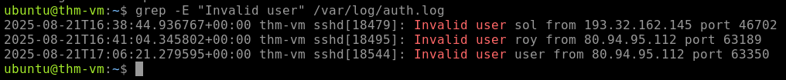
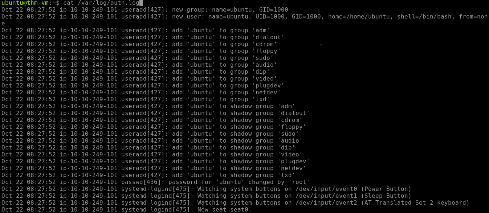
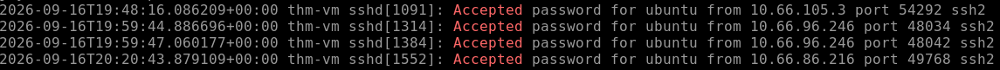
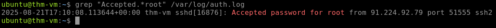
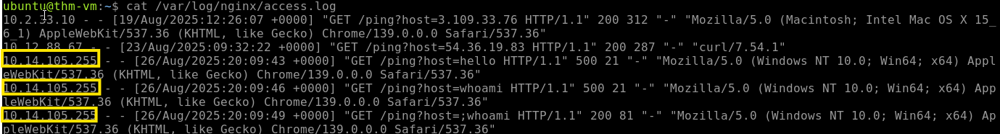
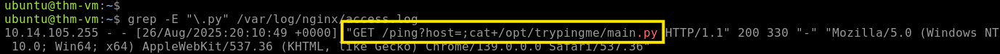

# Linux Threat Detection Investigation Series

## Threat Detection 1 — Initial Access

<table width="120%">
<tr>
<td width="100%">

### Lab Environment

This investigation was conducted in a controlled TryHackMe lab environment using the Linux Threat Detection 1 machine.

- **Platform:** TryHackMe
- **Room:** Linux Threat Detection 1 v5
- **Lab Target:** `10.66.178.85`
- **Focus:** Linux initial access and threat detection

</td>
</tr>
</table>

<table width="120%">
<tr>
<td width="100%">

### Investigation Overview

The purpose of this lab is to investigate how attackers can gain initial access to Linux systems through common attack techniques. The investigation focuses on SSH security, Internet-exposed services, and process analysis to identify how suspicious activity originated and how it can be detected through available Linux logs.

The exercises build on Linux logging concepts and provide hands-on practice identifying activity that could indicate an attempted or successful compromise.

### Investigation Objectives

- Analyze the security risks associated with SSH in Linux environments.
- Identify how exposed services can provide attackers with an entry point.
- Use process and parent-child relationships to trace suspicious activity back to its origin.
- Analyze Linux logs for evidence of initial-access activity.
- Develop a better understanding of how a SOC analyst can detect and investigate Linux attacks.

</td>
</tr>
</table>

---

# Task 2 — Initial Access via SSH

<table width="120%">
<tr>
<td width="100%">

## Question 1 — First SSH Login

**Question:** When did the `ubuntu` user log in via SSH for the first time?

**Answer:** `2024-10-02`

### Evidence


```bash
cat /var/log/auth.log | grep "sshd"
```

</td>
</tr>
</table>

<table width="120%">
<tr>
<td width="100%">

## Question 2 — SSH Authentication Method

**Question:** Did the `ubuntu` user use SSH keys instead of a password for the above found date?

**Answer:** **Yes**

### Evidence

I reviewed the SSH authentication logs using the following command:

```bash
cat /var/log/auth.log | grep "sshd"
```

The relevant information that confirmed this:

```text
Oct 22 08:28:00 ip-10-10-249-101 sshd[809]: Accepted publickey for ubuntu from 10.9.254.186 port 64824 ssh2: RSA SHA256:krhp4o9yYOyVKmAd7PAsdHrKQGJtjIQjt4w0K9R4kXg
```

</td>
</tr>
</table>

---

# Task 3 — Detecting SSH Attacks

<table width="120%">
<tr>
<td width="100%">

## Investigation Overview

SSH attacks can occur when public SSH access is exposed, password-based authentication is allowed, and users have weak passwords. Attackers can repeatedly attempt passwords through brute force until they successfully gain access.

When investigating SSH attacks, a useful starting point is to review successful SSH logins and look for signs that separate normal activity from suspicious activity. Key indicators include:

- **Authentication method:** Password-based authentication can be more suspicious than expected public-key authentication.
- **Source IP:** External or untrusted IP addresses should be investigated.
- **Login timing and history:** Unusual login times or successful logins following repeated failed attempts may indicate a compromise.

A suspicious SSH login should not automatically be considered malicious. Additional investigation should include the username and whether the login was expected, the reputation and ownership of the source IP, previous login attempts or brute-force activity, and what actions occurred after the login.

The goal of this task is to use SSH authentication logs to identify suspicious login activity and determine what additional evidence is needed before reaching a final conclusion.

</td>
</tr>
</table>

<table width="120%">
<tr>
<td width="100%">

## Question 1 — SSH Brute Force Start

**Question:** When did the SSH password brute force start?

**Answer:** The brute force began at: `2025-08-21`

### Evidence

I reviewed the SSH authentication logs using the following command:

```bash
cat /var/log/auth.log | grep "Failed password"
```


</td>
</tr>
</table>

<table width="120%">
<tr>
<td width="100%">

## Question 2 — Which four users did the botnet attempt to breach?

**Answer Format:** Separate by a comma, in alphabetical order.

#### Answer: `root, roy, sol, user`

### Initial Search

I initially searched the authentication log using:

```bash
cat /var/log/auth.log | grep -E 'Accepted'
```

This produced authentication events for users who successfully authenticated, resulting in a broad list that did not identify the usernames the botnet attempted to breach.

The search was not useful for this question because `Accepted` filters for successful authentication attempts, while the question is asking which users the botnet attempted to compromise. Failed authentication attempts and attempts against invalid users provide more relevant evidence for identifying the targeted usernames.

### Evidence


### Refined Search

Since the scenario involves a botnet attempting to compromise user accounts, I focused on authentication events that indicated attempted access rather than successful authentication. I therefore changed my search to specifically identify attempts made against invalid or nonexistent usernames.

```bash
grep -E "Invalid user" /var/log/auth.log
```



This produced a more concise result and allowed me to identify the usernames the botnet attempted to target.

</td>
</tr>
</table>

<table width="120%">
<tr>
<td width="100%">

## How?

### Why I Used This Command

I used `grep` to search the SSH authentication log for a specific pattern related to the attack.

```bash
grep -E "Invalid user" /var/log/auth.log
```

### Breaking Down the Command

- **`grep`** — Searches a file for matching text.
- **`-E`** — Enables Extended Regular Expressions, allowing more complex search patterns.
- **`"Invalid user"`** — Searches specifically for SSH attempts made against usernames that were not valid on the system.
- **`/var/log/auth.log`** — The authentication log containing SSH login activity.

### My Reasoning

Because the investigation focused on identifying **usernames that the botnet attempted to compromise**, I narrowed the search to `"Invalid user"`.

This provided a more targeted and concise view of the attack activity compared to searching for multiple SSH authentication events at once.

</td>
</tr>
</table>

<table width="120%">
<tr>
<td width="100%">

## Question 3 — Which IP managed to breach the root user?

**Objective:** Identify the source IP address associated with the successful SSH authentication of the `root` account.

### Step 1 — Review the authentication log

```bash
cat /var/log/auth.log
```



I initially reviewed the full authentication log to understand the available SSH activity.

**Issue:** The results were too broad and contained multiple types of authentication events.

### Step 2 — Search for successful authentications

```bash
grep "Accepted" /var/log/auth.log
```


I narrowed the search to `Accepted` events because the question asks which IP managed to breach the account, indicating that a successful authentication should be present.

**Issue:** The results still included successful authentications for multiple users, such as `ubuntu`.

For example:

```bash
Accepted password for ubuntu from 10.66.86.216
Accepted password for ubuntu from 10.66.105.3
Accepted password for ubuntu from 10.66.96.246
```

These IP addresses successfully authenticated, but they authenticated as `ubuntu`, not `root`.

### Step 3 — Filter for the root account

```bash
grep "Accepted.*root" /var/log/auth.log
```

I further narrowed the search by combining `Accepted` with `root`.

- **`Accepted`** → The authentication was successful.
- **`.*`** → Allows any characters between `Accepted` and `root`.
- **`root`** → Limits the results to successful authentication involving the root account.

This removes successful authentications for other accounts and isolates the relevant successful `root` login.

### Conclusion

The final search is the most relevant because it specifically identifies **successful authentication events involving the `root` account**, rather than successful logins to other accounts such as `ubuntu`.

The relevant log entry identifies:

```text
Accepted ... for root from 91.224.92.79
```

The evidence establishes three important points:

- **`Accepted`** → The authentication was successful.
- **`for root`** → The account successfully accessed was `root`.
- **`from 91.224.92.79`** → `91.224.92.79` was the source IP address.

Therefore, the IP that managed to breach the `root` user was:

**Answer:** 

</td>
</tr>
</table>


# Task 4 — Initial Access via Services

<table width="120%">
<tr>
<td width="100%">

## Investigation Overview

This task focuses on identifying **initial access through publicly exposed services**, with an emphasis on web applications running on Linux systems. Public-facing services can become an entry point for attackers when applications contain vulnerabilities or are improperly configured.

The investigation uses application and web server logs to identify suspicious requests that may indicate exploitation, command injection, or other malicious activity. These logs can provide valuable evidence of attacker activity, although they may not reveal the complete sequence of events occurring on the underlying Linux system.

A key part of the investigation is distinguishing normal application requests from activity that may indicate an attacker is attempting to execute commands or exploit a vulnerable service.

## Objective

The objective is to analyze the available web application logs, identify suspicious requests, and determine whether the activity provides evidence of exploitation against the public-facing service.

The investigation focuses on:

- Identifying the **source IP address** associated with suspicious activity.
- Identifying the **public-facing service or application** being targeted.
- Analyzing request parameters for evidence of **command injection or exploitation**.
- Determining whether the attacker appears to have attempted **OS command execution**.
- Assessing whether the available evidence indicates a potential compromise of the underlying **Linux system**.

</td>
</tr>
</table>

---

<table width="120%">
<tr>
<td width="100%">

<table width="120%">
<tr>
<td width="100%">

<table width="120%">
<tr>
<td width="100%">

## Question 4 — What is the path to the Python file the attacker attempted to open?

**Question:** What is the path to the Python file the attacker attempted to open?

**Answer:** `/opt/trypingme/main.py`

### Step 1 — Review the Nginx Access Log

I began by reviewing the Nginx access log to identify suspicious requests against the web application.

```bash
cat /var/log/nginx/access.log
```

While reviewing the requests, I noticed activity from the same external IP address:

```text
10.14.105.255
```


The requests were targeting the `/ping` endpoint and included values such as:

```text
GET /ping?host=hello HTTP/1.1
GET /ping?host=whoami HTTP/1.1
```

The `whoami` request stood out because `whoami` is a Linux command used to identify the current user.

This suggested that the attacker may have been testing whether input supplied to the `host` parameter was being interpreted as a system command.

### Step 2 — Search for Python File References

Since the question asks specifically for a Python file, I narrowed the search to requests containing the `.py` extension.

```bash
grep -E "\.py" /var/log/nginx/access.log
```



The escaped period (`\.`) searches for the literal `.py` extension rather than treating `.` as a regular-expression wildcard.

This reduces the large access log to requests that reference Python files, making it easier to identify the file involved in the attack.

### Step 3 — Identify the Suspicious Request

The search revealed the following request:

```text
10.14.105.255 - - [26/Aug/2025:20:10:49 +0000] "GET /ping?host=;cat+/opt/trypingme/main.py HTTP/1.1" 200 330 "-" "Mozilla/5.0 (Windows NT 10.0; Win64; x64) AppleWebKit/537.36 (KHTML, like Gecko) Chrome/139.0.0.0 Safari/537.36"
```

The important portion is:

```text
host=;cat+/opt/trypingme/main.py
```

This is significant because the attacker is no longer simply supplying a hostname or IP address to the `/ping` function.

Instead, the `host` parameter contains a shell command:

```text
cat /opt/trypingme/main.py
```

The `cat` command is commonly used on Linux to read and display the contents of a file.

Therefore, the request indicates an attempt to use the application's `host` parameter to execute a command that would read a Python source file from the server.

### Step 4 — Trace the Evidence to the File

The relevant portion of the request can be broken down as:

```text
/ping
   ↓
host=
   ↓
;
   ↓
cat
   ↓
/opt/trypingme/main.py
```

The semicolon is significant because it can be used to separate commands in a shell command line.

The attacker therefore appears to have attempted to inject a command into the `host` parameter and use `cat` to open/read the Python source file.

The file path is directly visible in the request:

```text
/opt/trypingme/main.py
```

### Conclusion

The Nginx access log provides a direct connection between the suspicious `/ping` request and the Python file targeted by the attacker.

The evidence shows:

- **Source:** `10.14.105.255`
- **Endpoint:** `/ping`
- **Parameter:** `host`
- **Command:** `cat`
- **Target file:** `/opt/trypingme/main.py`

The request demonstrates an attempted command injection through the `/ping` endpoint, with the attacker attempting to use `cat` to read the Python source file.

**Answer:** `/opt/trypingme/main.py`

</td>
</tr>
</table>


```
